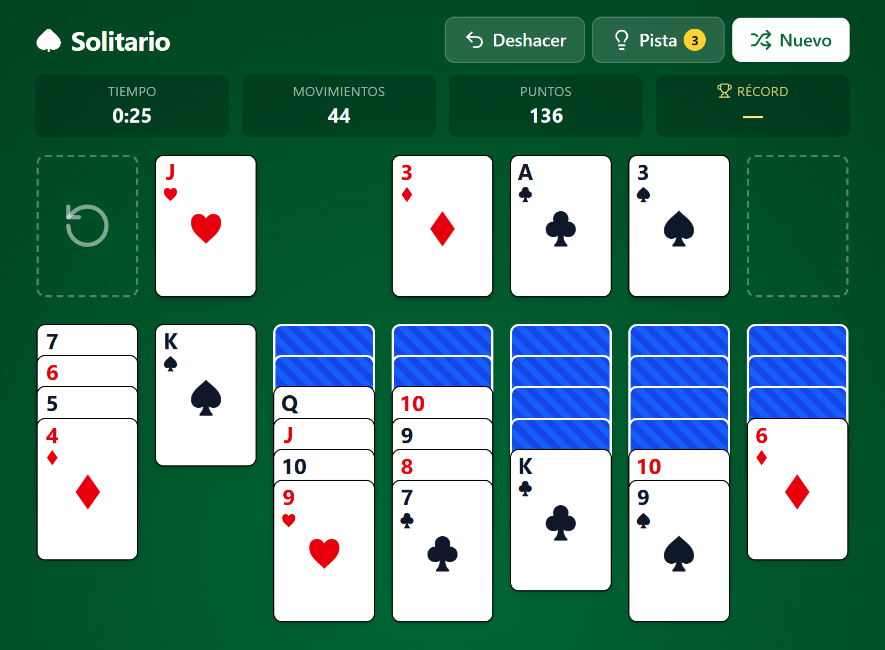

# Klondike Solitaire

[Español](README.md) · **English**

[](https://sergiobytes.github.io/klondike-devcrafters/)

The good old classic solitaire, built for the browser with TypeScript, Vite and Tailwind CSS. Play it with a mouse, a keyboard or a touch screen. The interface is in Spanish.

**[Play now →](https://sergiobytes.github.io/klondike-devcrafters/)**

## Features

- **Drag and drop** single cards or whole runs, with a mouse or a finger. The valid destination lights up while you drag, and if you drop the cards somewhere they can't go, they fly back.
- **Undo** with no practical limit (up to 300 moves in a row).
- **3 hints per game**: the suggested card and its destination pulse in gold for a few seconds.
- **Game over detection**: when no useful move is left, the game tells you and offers to undo or start a new one.
- **Auto-complete**: once every tableau card is face up, a button finishes the game for you.
- **Timer**, **moves** and **score** always on screen. The clock starts with your first move and pauses when you switch tabs.
- **Best score** saved in the browser (`localStorage`), with that game's time and moves.
- **Animations** when dealing, moving, flipping and recycling the stock, turned off when the system asks for reduced motion.
- **Responsive layout**: the seven columns always fit on screen, from phone to desktop.

## How to play

The goal is to move all 52 cards to the four **foundations** (top right), one per suit, from Ace to King.

- On the **tableau**, cards are stacked in descending order and alternating colours (a red 7 on a black 8). An ordered run can be moved as a whole.
- Only a **King** (or a run starting with one) can fill an empty column.
- Clicking the **stock** draws one card to the waste. When the stock runs out it shows a reset icon: click it to turn the waste back over into the stock, as many times as you like.
- When a face-down tableau card is uncovered, it turns over by itself.

### Controls

| Action | How |
| --- | --- |
| Move cards | Drag them, or click the card and then its destination |
| Send a card to a foundation | Click it twice |
| Draw from the stock | Click the stock |
| Undo | **Deshacer** (Undo) button or `Ctrl+Z` / `⌘Z` |
| Get a hint | **Pista** (Hint) button or the `H` key |
| Cancel the selection or close a dialog | `Esc` |

### Scoring

| Move | Points |
| --- | --- |
| Card to a foundation | +10 |
| Card from the waste to the tableau | +5 |
| Turning over a tableau card | +5 |
| Card from a foundation back to the tableau | −15 |
| Turning the waste back over into the stock | −20 |
| Every 10 seconds of play | −2 |
| Win bonus (games of 30 s or more) | 700,000 ÷ seconds |

The score never goes below 0. Undo gives back the points of the move, but counts as one more move. Hints are free.

## Development

Requirements: **Node.js 22.12+ or 24+**, on an LTS release (what Vite 8 and Vitest 5 need).

```bash
npm install      # install the dependencies
npm run dev      # development server with hot reload
npm run build    # type-check and build for production into dist/
npm run preview  # serve dist/ locally to try the build
```

### Tech stack

- [TypeScript](https://www.typescriptlang.org/), no framework: the DOM is handled directly.
- [Vite](https://vite.dev/) for the dev server and the build.
- [Tailwind CSS v4](https://tailwindcss.com/) for styling.
- [Lucide](https://lucide.dev/) for the icons. Only the ones in use end up in the bundle.
- [Vitest](https://vitest.dev/) for the unit tests.

### Structure

```
src/
├── main.ts      # Startup and events: clicks, keyboard, hints and dialogs
├── game.ts      # Game state, moves, undo, auto-complete and hints
├── rules.ts     # Klondike rules: which card can go where
├── deck.ts      # Building and shuffling the deck (Fisher-Yates)
├── scoring.ts   # Scoring and best score in localStorage
├── timer.ts     # Timer
├── render.ts    # Drawing the table, animations and the scoreboard
├── drag.ts      # Drag and drop with Pointer Events (mouse, touch and pen)
├── icons.ts     # Lucide icons
├── types.ts     # Shared types
├── style.css    # Tailwind theme, card size and animations
└── *.test.ts    # Unit tests, with shared builders in test-helpers.ts
```

The game logic (`game.ts`, `rules.ts`, `deck.ts`, `scoring.ts`) doesn't depend on the DOM; everything visual lives in `render.ts` and `drag.ts`.

## Tests

The game logic has unit tests with Vitest: rules, deck, deal, undo, auto-complete, hints, game over and scoring.

```bash
npm test               # run the tests once
npm run test:coverage  # same, plus the coverage report (in the console and in coverage/)
npx vitest             # watch mode: reruns them on save
```

Coverage is measured over the logic modules (`game.ts`, `rules.ts`, `deck.ts`, `scoring.ts`); the visual side (`render.ts`, `drag.ts`, `main.ts`) is tested by playing.

## Deployment

Every push to `main` publishes the game to GitHub Pages through the [`.github/workflows/deploy.yml`](.github/workflows/deploy.yml) workflow: it installs the dependencies, runs the tests, builds and uploads `dist/` to Pages. If a test fails, nothing is deployed. It can also be run by hand from the **Actions** tab.

The `base` option in [`vite.config.ts`](vite.config.ts) (`/klondike-devcrafters/`) has to match the repository name. If you fork it under another name, change it or the assets will 404.
